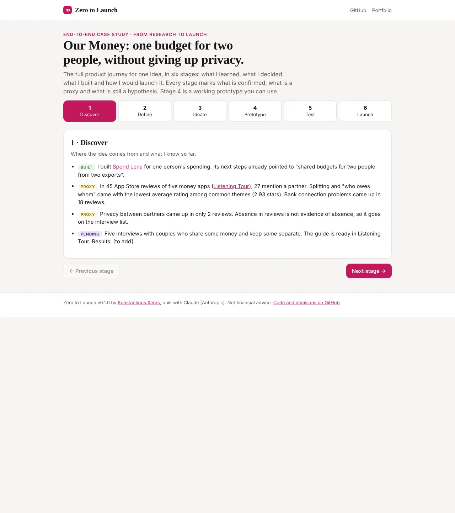

# Zero to Launch

**An end-to-end PM case study for Our Money, a shared budget for couples that keeps personal spending private, from research to launch plan, with a working prototype.**

**Current version:** 0.1.0

Live: https://kostasxeras.com/zero-to-launch/



## The question

Most PM case studies show one stage well and skip the rest. I wanted one idea taken through every stage: discover, define, ideate, prototype, test and launch, with each claim marked as confirmed, proxy or hypothesis. The idea comes from my own work: Spend Lens covers one person's spending, and couples who share some money and keep some separate are the obvious next problem.

## Who it is for

- Hiring managers who want to see an end-to-end product process
- Couples who share some costs and keep some money personal (the users of the product itself)

## What is inside

- **Six-stage case study** with navigation and links that work per stage
- **Evidence labels**: built, proxy, pending, hypothesis
- **Define**: who, job to be done, problem statement, principles
- **Ideate**: three options and why I chose one, plus the riskiest assumptions
- **Working prototype**: two partners, shared and personal payments, a 50/50 or income-based fair-share rule, shared budget by category, a settle-up action, and a privacy view that hides each partner's personal payments from the other
- **Test plan** for the three riskiest assumptions, with placeholders
- **Launch plan**: launch inside Spend Lens, invite loop, rollout, metrics with a privacy guardrail, risks

## Main findings

Full detail in the [case study](docs/case-study.md).

- **Partners are a common theme in money app reviews** (proxy). 27 of 45 App Store reviews in Listening Tour mention a partner.
- **Splitting is where ratings drop** (proxy). Splitting and who owes whom averaged 2.93 stars in the same sample, the lowest among common themes. This shaped the choice of a fair-share rule instead of a running debt.
- **Partly-sharing couples are underserved** (hypothesis). Not tested yet. Interviews and a two-week prototype test are planned.

## Data and sources

The prototype starts with made-up sample data for a fictional couple, labelled on screen. Evidence comes from the [Listening Tour](https://kostasxeras.com/listening-tour/) review proxy (45 App Store reviews, keyword-coded). No interviews have been run yet.

## Decisions

- [A fair-share rule instead of a running debt](docs/decisions/0001-fair-share-not-debt.md)
- [Personal payments are hidden from the partner](docs/decisions/0002-personal-is-private.md)
- [Launch inside Spend Lens, not as a new app](docs/decisions/0003-feature-not-app.md)

## How I would measure success

Targets will be set after the prototype test.

| Measure | Definition | Target |
|---|---|---|
| Both partners active | Share of invites accepted | [x]% |
| Shared marking | Share of shared payments marked within 3 days | [x]% |
| Second-month return | Couples returning in month two | [x]% |

## What I would do next

1. Run five interviews with Listening Tour and update Discover
2. Run the two-week prototype test with [5] couples
3. Build encrypted export and import between partners

## How it was built

I framed the problem, made the product calls and wrote the conclusions. Claude (Anthropic) was my engineering partner for the code. 

## Run it yourself

One HTML page with no build step. Open `index.html` through any local web server, for example `python3 -m http.server`, then go to http://localhost:8000.

## Repo layout

```
index.html               The page
app.css                  Shared base styles
docs/product-brief.md    Problem, users, goals, scope
docs/case-study.md       Approach, decisions, findings, next steps
docs/decisions/          One record per real tradeoff
docs/screenshots/        Desktop and mobile
```
